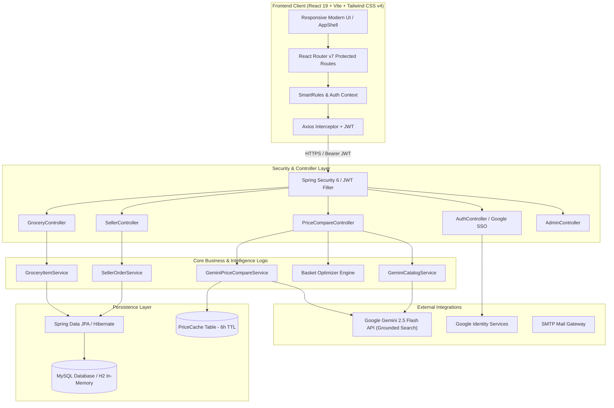

# 🛒 Smart Grocery & Kirana Intelligence System (Shree Data Kirana)

[](https://spring.io/projects/spring-boot)
[](https://react.dev/)
[](https://tailwindcss.com/)
[](https://openjdk.org/)
[](https://www.mysql.com/)
[](https://ai.google.dev/)
[](https://jwt.io/)
[](LICENSE)

An intelligent, full-stack grocery management, local Kirana enablement, and real-time quick-commerce arbitrage platform. Built for consumers, local Kirana store owners, and administrators to bridge the gap between hyperlocal offline stores and modern quick commerce platforms.

---

## 📌 Table of Contents

- [Overview & Problem Statement](#-overview--problem-statement)
- [Key Features](#-key-features)
- [Multi-Tier Role Ecosystem](#-multi-tier-role-ecosystem)
- [System Architecture](#-system-architecture)
- [Tech Stack](#-tech-stack)
- [Repository Structure](#-repository-structure)
- [Quick Commerce Price Engine & Basket Optimization](#-quick-commerce-price-engine--basket-optimization)
- [API Reference](#-api-reference)
- [Local Development & Setup](#-local-development--setup)
  - [Prerequisites](#prerequisites)
  - [Backend Setup (Spring Boot)](#backend-setup-spring-boot)
  - [Frontend Setup (React + Vite)](#frontend-setup-react--vite)
  - [Environment Configuration](#environment-configuration)
- [Production Deployment](#-production-deployment)
- [Documentation & FYP Report](#-documentation--fyp-report)
- [Contributing & License](#-contributing--license)

---

## 🌟 Overview & Problem Statement

In the modern Indian retail landscape, consumers face a dual challenge:
1. **Hyperlocal Price Fragmentation**: Major quick commerce platforms (Blinkit, Zepto, Swiggy Instamart, BigBasket, Amazon Fresh) charge wildly varying prices and surge delivery/platform fees for identical household essentials.
2. **Traditional Kirana Disconnect**: Neighborhood Kirana stores lack digitized credit ledgers (*Udhar Khata*), automated inventory restocking, and online catalog presence.
3. **Household Food Wastage**: Households routinely suffer food spoilage due to untracked expiration dates and unorganized purchase queues.

**Smart Grocery & Kirana Intelligence System (Shree Data Kirana)** provides a complete, unified solution:
- **For Households**: Track grocery inventory, set expiration alerts, receive auto-restock recommendations, parse recipes into shopping lists using AI, and compare live quick-commerce prices with automated basket optimization.
- **For Kirana Stores (Sellers)**: Manage digital inventory, fulfill neighborhood orders, and maintain a digital customer credit ledger (*Udhar Khata*).
- **For Admins & Superadmins**: Platform-wide catalog governance, seller approvals, audit reports, and multi-tenant telemetry.

---

## 🚀 Key Features

### 1. 🤖 AI-Powered Quick-Commerce Price Comparison
- **Live Grounded Search**: Queries live web data via Google Gemini 2.5 Flash to fetch actual market prices across **Blinkit**, **Swiggy Instamart**, **Zepto**, **BigBasket**, **Amazon India**, and **Flipkart**.
- **Automated Price Flagging**: Automatically identifies and highlights the lowest market price per product.
- **Direct Store Deep Links**: Intelligent redirect resolvers provide clean, direct links to products on each platform without broken grounding redirects.
- **Multi-Tier Smart Caching**: Cached in MySQL/H2 with a 6-hour sliding window (`PriceCache`) to minimize API latencies and token usage.

### 2. 🧮 Mathematical Basket Optimizer (Whole Cart vs Split Order)
- Solves the multi-store checkout trade-off:
  - **Option A (All-in-One Cart)**: Consolidating all items into a single store to avoid duplicate delivery and platform fees.
  - **Option B (Split Basket)**: Splitting purchases across multiple platforms where item discounts exceed added delivery fees.
- Factoring in store delivery thresholds (e.g., free delivery over ₹199, ₹25 delivery fee otherwise) + standard platform handling fees (₹5).
- Displays exact net rupee savings and clear algorithmic recommendations.

### 3. 🍳 Recipe-to-Cart AI Parser
- Paste any recipe, raw meal plan, or unstructured ingredients list in plain text.
- Google Gemini extracts product names, estimates packaging quantities, standardizes units, and populates the price comparison cart in one click.

### 4. 📒 Local Kirana Digital Khata (Udhar Khata Ledger)
- Designed for authentic Indian Kirana operations.
- Maintain customer-wise credit balances, track debit/credit ledger histories, record settlements, and monitor outstanding dues.

### 5. 📦 Smart Household Inventory & Expiry Watchdog
- **Real-Time Inventory**: Track item stock levels, categories, and locations (Pantry, Fridge, Spice Rack).
- **Expiry Countdown**: Proactive reminders for items expiring today, tomorrow, or within 3 days.
- **Smart Restock Triggers**: Configurable low-stock thresholds that auto-populate the shopping queue.
- **One-Click Buy Status**: Seamless transition between "Pending", "Purchased", and "Consumed".

### 6. 🔒 Enterprise Security & Multi-Tenant RBAC
- Stateless JWT-based authentication with expiration controls.
- Google OAuth2 Single Sign-On (SSO) integration.
- Granular Role-Based Access Control (RBAC) across 4 permission tiers.
- Password hashing using BCrypt and protected API interceptors.

---

## 👥 Multi-Tier Role Ecosystem

| Role | Target Persona | Capabilities |
| :--- | :--- | :--- |
| **`USER`** | Household Consumer | Manage inventory, track expiry, create shopping lists, compare quick-commerce prices, optimize carts, parse recipes, view personal Udhar Khata. |
| **`SELLER`** | Kirana Store Owner | Manage store catalog, update local stock and pricing, review incoming customer orders, manage customer credit ledgers (*Udhar Khata*), view store analytics. |
| **`ADMIN`** | Operations Manager | Curate master catalog taxonomy, manage system users, oversee order queues, monitor system-wide inventory audit reports. |
| **`SUPER_ADMIN`** | Platform Overseer | Multi-seller approval/onboarding, global user management, platform financial analytics, system health monitoring. |

---

## 🏗 System Architecture



---

## 💻 Tech Stack

### Frontend
- **Framework**: [React 19](https://react.dev/) with [Vite](https://vitejs.dev/)
- **Routing**: [React Router v7](https://reactrouter.com/) (Lazy-loaded route splitting & RBAC guards)
- **Styling**: [Tailwind CSS v4](https://tailwindcss.com/)
- **Charts & Data Viz**: [Recharts](https://recharts.org/)
- **Icons**: [Lucide React](https://lucide.dev/)
- **HTTP Client**: [Axios](https://axios-http.com/)
- **Analytics**: [@vercel/analytics](https://vercel.com/analytics)

### Backend
- **Framework**: [Spring Boot 3](https://spring.io/projects/spring-boot) (Java 21)
- **Security**: Spring Security 6, JJWT (io.jsonwebtoken 0.11.5), Google API Client (OAuth2)
- **ORM & Data**: Spring Data JPA, Hibernate ORM
- **Database**: MySQL 8+ with H2 In-Memory fallback for instant demo/testing
- **AI Engine**: Google Gemini 2.5 Flash API (`gemini-2.5-flash`) with Grounded Search
- **Utilities**: Lombok, Jackson Databind, Spring Mail Starter

### DevOps & Tools
- **Containerization**: Dockerfile for backend container builds
- **Build Tooling**: Maven Wrapper (`mvnw` / `mvnw.cmd`), npm / Vite
- **Cloud Hosting**: Vercel (`vercel.json` for SPA rewrites), Render / Docker support

---

## 📂 Repository Structure

```text
Smart-Grocery-Story-Data-Kirana-/
├── backend/                               # Spring Boot 3 API Server
│   ├── src/main/java/com/example/backend/
│   │   ├── BackendApplication.java        # Main Spring Boot Entrypoint
│   │   ├── config/                        # SecurityConfig, CorsConfig, PasswordEncoder
│   │   ├── controller/                    # REST API Controllers (Auth, Grocery, PriceCompare, Seller, Admin)
│   │   ├── dto/                           # Data Transfer Objects (PriceOption, BasketOptimization, etc.)
│   │   ├── entity/                        # JPA Entities (User, GroceryItem, PriceCache, SellerOrder, etc.)
│   │   ├── repository/                    # Spring Data JPA Repositories
│   │   ├── security/                      # JwtService, JwtFilter, CustomUserDetails
│   │   └── service/                       # Business Logic, Gemini Integration & Basket Optimization
│   ├── src/main/resources/
│   │   ├── application.properties         # Active runtime properties (supports env vars)
│   │   └── application.properties.template# Template for custom MySQL & credentials setup
│   ├── Dockerfile                         # Container definition for backend deployment
│   ├── mvnw & mvnw.cmd                    # Maven wrappers
│   └── pom.xml                            # Project dependencies and plugins
├── frontend/                              # React 19 + Vite Web Application
│   ├── src/
│   │   ├── api/                           # Axios instance and API service calls
│   │   ├── components/                    # AppShell, AdminShell, ProtectedRoute, UI components
│   │   ├── context/                       # SmartRulesContext, AuthContext
│   │   ├── pages/                         # Core Pages (Home, Inventory, PriceCompare, UdharKhata, etc.)
│   │   │   ├── seller/                    # Kirana Seller Workspace (Dashboard, Products, Orders, Analytics)
│   │   │   └── superadmin/                # Superadmin Workspace (Users, Sellers, Platform Analytics)
│   │   ├── App.jsx                        # Root Router & Suspense Fallbacks
│   │   └── main.jsx                       # Application bootstrapping
│   ├── .env.example                       # Frontend environment variables template
│   ├── .env.production                    # Production API and OAuth endpoints
│   ├── package.json                       # Frontend dependencies and build scripts
│   └── vite.config.js                     # Vite build configuration with Tailwind CSS plugin
├── docs/                                  # Project Documentation
│   └── Smart_Grocery_FYP_Report.pdf       # Comprehensive Final Year Project (FYP) Engineering Report
├── vercel.json                            # Vercel deployment routing configuration
└── README.md                              # Complete Project Documentation
```

---

## ⚡ Quick Commerce Price Engine & Basket Optimization

### The Problem
When purchasing groceries online, different platforms provide vastly different pricing:
- Store A might have cheaper milk and cooking oil.
- Store B might have cheaper basmati rice and eggs.
- However, purchasing from both stores introduces **separate delivery fees** (e.g., ₹25 if order < ₹199) and **platform fees** (₹5).

### The Solution Algorithm
The `GeminiPriceCompareService` evaluates:
1. **Single-Store Best Coverage**:
   $$\text{Total}_{\text{Single}} = \sum \text{Item Price} + \text{Delivery Fee} + \text{Platform Fee}$$
2. **Split-Basket Optimization**:
   $$\text{Total}_{\text{Split}} = \sum_{\text{Stores}} \left( \sum \text{Cheapest Store Items} + \text{Delivery Fee}_{\text{Store}} + \text{Platform Fee} \right)$$
3. **Net Rupee Arbitrage Decision**:
   $$\Delta = \text{Total}_{\text{Single}} - \text{Total}_{\text{Split}}$$
   - If $\Delta > 0$, the system highlights: **"Split Order Wins! (Max Savings)"** detailing exact store allocations.
   - If $\Delta \le 0$, the system highlights: **"All-in-One Cart Wins!"** advising the user to stick to a single platform to avoid redundant delivery charges.

---

## 🔌 API Reference

### Authentication (`/api/auth`)
| Method | Endpoint | Description | Access |
| :--- | :--- | :--- | :--- |
| `POST` | `/api/auth/register` | Register a new user (`USER` or `SELLER`) | Public |
| `POST` | `/api/auth/login` | Authenticate with email/password and obtain JWT | Public |
| `POST` | `/api/auth/google` | Verify Google OAuth2 ID token and authenticate | Public |
| `GET` | `/api/auth/me` | Fetch currently logged-in user profile | Authenticated |

### Grocery & Inventory (`/api/grocery`)
| Method | Endpoint | Description | Access |
| :--- | :--- | :--- | :--- |
| `GET` | `/api/grocery/items` | List user inventory items | User |
| `POST` | `/api/grocery/items` | Add new item with quantity, category, expiry | User |
| `PUT` | `/api/grocery/items/{id}` | Update item details, stock quantity, or status | User |
| `DELETE`| `/api/grocery/items/{id}` | Delete inventory item | User |
| `POST` | `/api/grocery/items/{id}/purchase` | Toggle item purchase status & set expiry | User |
| `GET` | `/api/grocery/expiry-alerts` | Retrieve items expiring today or within 3 days | User |
| `GET` | `/api/grocery/recommendations` | Get auto-restock recommendations | User |

### Price Comparison & Basket Optimization (`/api/price-compare`)
| Method | Endpoint | Description | Access |
| :--- | :--- | :--- | :--- |
| `POST` | `/api/price-compare/search` | Compare live quick-commerce prices by product list or recipe text | Authenticated |
| `POST` | `/api/price-compare/optimize-basket` | Calculate single-store vs split-basket cost optimization | Authenticated |
| `GET` | `/api/price-compare/analytics` | Fetch monthly spending metrics and estimated savings | Authenticated |

### Seller Operations (`/api/seller`)
| Method | Endpoint | Description | Access |
| :--- | :--- | :--- | :--- |
| `GET` | `/api/seller/products` | Get seller catalog items | Seller / Superadmin |
| `POST` | `/api/seller/products` | Create or update seller product and inventory | Seller |
| `GET` | `/api/seller/orders` | Retrieve customer orders for seller | Seller |
| `PUT` | `/api/seller/orders/{id}/status` | Update order fulfillment status (Pending, Delivered) | Seller |
| `GET` | `/api/seller/analytics` | Fetch seller store revenue and order metrics | Seller |

### Admin & Governance (`/api/admin`)
| Method | Endpoint | Description | Access |
| :--- | :--- | :--- | :--- |
| `GET` | `/api/admin/metrics` | Retrieve total users, active items, stock counts | Admin / Superadmin |
| `GET` | `/api/admin/users` | List and manage platform users | Admin / Superadmin |
| `GET` | `/api/admin/categories` | Manage global product categories | Admin / Superadmin |
| `GET` | `/api/admin/reports` | Export system-wide inventory audit reports | Admin / Superadmin |

---

## 🛠 Local Development & Setup

### Prerequisites
- **Java**: OpenJDK 21 or higher installed (`java -version`)
- **Node.js**: v20.x or higher with npm (`node -v` / `npm -v`)
- **MySQL**: (Optional) MySQL 8.x instance. If MySQL is not running, the application gracefully defaults to an in-memory **H2 database** with zero extra setup!
- **Google Gemini API Key**: (Optional for live price comparison) Get a free key from [Google AI Studio](https://aistudio.google.com/).

---

### Backend Setup (Spring Boot)

1. Navigate to the backend directory:
   ```bash
   cd backend
   ```

2. (Optional) Configure MySQL database credentials:
   Create or edit `backend/src/main/resources/application.properties`:
   ```properties
   server.port=8085
   spring.datasource.url=jdbc:mysql://localhost:3306/Smart_GG?createDatabaseIfNotExist=true
   spring.datasource.username=root
   spring.datasource.password=your_password
   spring.jpa.hibernate.ddl-auto=update

   # Security & Keys
   app.jwt.secret=YourSuperSecureLongRandomJwtSecretKeyForSmartGrocery2026
   app.ai.gemini.api-key=YOUR_GEMINI_API_KEY
   app.ai.gemini.model=gemini-2.5-flash
   ```

   > **Note on Zero-Config Demo**: By default, `application.properties` uses an embedded H2 in-memory database (`jdbc:h2:mem:smartgrocery`). You can run the backend immediately without installing or configuring MySQL!

3. Run the backend using the Maven wrapper:
   ```powershell
   # Windows
   .\mvnw.cmd spring-boot:run

   # macOS / Linux
   ./mvnw spring-boot:run
   ```

4. The backend will start at:
   ```text
   http://localhost:8085
   ```

---

### Frontend Setup (React + Vite)

1. Open a new terminal and navigate to the frontend directory:
   ```bash
   cd frontend
   ```

2. Install dependencies:
   ```bash
   npm install
   ```

3. Configure environment variables:
   Copy `.env.example` to `.env`:
   ```bash
   cp .env.example .env
   ```
   Configure `VITE_API_URL` (defaults to `http://localhost:8085` in dev mode if omitted):
   ```env
   VITE_API_URL=http://localhost:8085
   VITE_GOOGLE_CLIENT_ID=your-google-oauth-client-id.apps.googleusercontent.com
   ```

4. Start the Vite development server:
   ```bash
   npm run dev
   ```

5. Open your browser and navigate to:
   ```text
   http://localhost:5173
   ```

---

### Default Seed Credentials

For quick local evaluation, the database pre-seeds an administrative account:
- **Username**: `admin`
- **Email**: `admin@gmail.com`
- **Password**: `Admin@123`
- **Role**: `ADMIN`

---

## 🌐 Production Deployment

### Frontend (Vercel)
The repository includes `vercel.json` configured for single-page app (SPA) routing:
```json
{
  "rewrites": [
    {
      "source": "/(.*)",
      "destination": "/index.html"
    }
  ]
}
```
1. Connect this GitHub repository to [Vercel](https://vercel.com).
2. Set Root Directory to `frontend`.
3. Set the environment variable: `VITE_API_URL=https://your-backend-api.onrender.com`.
4. Deploy!

### Backend (Docker / Render / Railway)
The backend includes a production-ready `Dockerfile`:
```dockerfile
FROM eclipse-temurin:21-jdk-jammy AS build
WORKDIR /app
COPY .mvn/ .mvn
COPY mvnw pom.xml ./
RUN ./mvnw dependency:go-offline
COPY src ./src
RUN ./mvnw clean package -DskipTests

FROM eclipse-temurin:21-jre-jammy
WORKDIR /app
COPY --from=build /app/target/*.jar app.jar
EXPOSE 8085
ENTRYPOINT ["java", "-jar", "app.jar"]
```
Deploy directly to [Render](https://render.com) as a Web Service by referencing the `backend/` directory or container Dockerfile.

---

## 📄 Documentation & FYP Report

Comprehensive engineering documentation is included in the repository:
- **Final Year Project (FYP) Report**: [`docs/Smart_Grocery_FYP_Report.pdf`](docs/Smart_Grocery_FYP_Report.pdf)
  - Detailed system design, data flow diagrams, ER schemas, test matrices, and experimental evaluation results.

---

## 🤝 Contributing

Contributions, bug reports, and feature requests are welcome!
1. Fork the Project
2. Create your Feature Branch (`git checkout -b feature/AmazingFeature`)
3. Commit your Changes (`git commit -m 'Add some AmazingFeature'`)
4. Push to the Branch (`git push origin feature/AmazingFeature`)
5. Open a Pull Request

---

## 📜 License

Distributed under the MIT License. See `LICENSE` for more information.

---

**Developed with ❤️ by [Ritesh Bhende](https://github.com/riteshbhende)**
